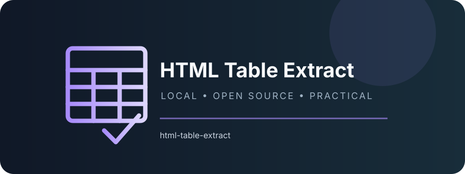

<p align="center"></p>
<p align="center"></p>
<p align="center">   </p>
<p align="center"></p>

## 🧭 Overview
HTML Table Extract reads saved HTML files and exports their top-level tables as CSV or JSON. It works offline and never uploads documents.

## ✨ Features
- 📋 Extracts rows and cells from top-level HTML tables.
- 📤 Exports a selected table as CSV or JSON.
- 🧱 Pads uneven rows for consistent output.
- 🔒 Uses Python's standard library.

## 🎬 Demo
```text
$ python main.py examples/report.html --format csv
Name,Status,Count
Alpha,Ready,12
Beta,Review,8
```
This is a local example, not a hosted demo.

## 🚀 Quick Start
```bash
python -m pip install -r requirements.txt
python main.py examples/report.html --format csv
```
Use `--table 2` to select the second table and `--output result.csv` to write a file.

## 🧰 Tech Stack
- Python 3.10+
- html.parser, csv, and json from the standard library
- unittest

## 🗂️ Folder Structure
```text
main.py
table_extract.py
tests/test_table_extract.py
examples/report.html
assets/overview.svg
requirements.txt
```

## 🗺️ Roadmap
- [x] Top-level table extraction
- [x] CSV and JSON export
- [ ] Optional handling for row and column spans

## 🤝 Contributing
Issues and focused pull requests are welcome. Add regression tests for parser edge cases.

## 📄 License
Released under the [MIT License](LICENSE).

<p align="center"></p>
